# 方案 A · 「透かし和紙と水彩の雫」（逆光越前和纸影绘 × 矿物水彩凝露）

---

## 1. 一句话概念
> **「障子越しの花影と墨線のなかで、五つの指先だけが濡れた水彩の雫としてうる艶に宿る。」**
> （在透过手漉和纸摇曳的花影与淡墨手影之间，唯有五枚短甲如未干的矿物水彩凝露般立体发光。）

---

## 2. 视觉语言
- **艺术手法**：**逆光多层手漉和纸剪影剧场（Backlit Washi Paper-Cut Theater）+ 日本画矿物水彩毛细晕染（Nijimi）+ 局部三维高光清漆层**（气质借鉴 BAUM 逆光纸艺剧场与 LONGLEAGE 柔雾纱影）。
- **手如何被象征化**：彻底抛弃写实人手照片（无毛孔、无指节皱纹、无 AI 假皮肤）。手是由**带毛边（耳付き）的暖白越前和纸层叠剪影 + 极细暖墨勾线**构成的半透光符号，只从画面侧边纸褶与窗影间探出半截指尖；而**五枚短椭圆甲面**则是全画面唯一具有高折射水润厚度（ちゅるん立体高光 + 玻璃感清透层）的主角。
- **色板**：
  - 透光手漉楮纸底 `#F6F0E8` / 纸影暖灰粉 `#E6D8D2`
  - 淡墨与活版字色 `#3B2B2C` / 次级和纸灰 `#7E6B6C`
  - 矿物水彩甲色：灰玫瑰 `#B97C86`、淡藤猫眼 `#9C8EB0`、透奶米 `#EAE2DC`、熟茜酒红 `#5C1624`
  - 点睛金箔细丝 `#C7A97F` 与朱砂落款印泥 `#A8585B`
- **字体**：标题与诗句用 **Shippori Mincho（しっぽり明朝）** 细体（配合 `mix-blend-mode: multiply` 吃进纸纤维，像真正的活版铅字压印在和纸上）；番号与价格用 **Cormorant Garamond**。
- **全站统一胶片母带层（Film Layer）**：
  - 5200K 晨间障子柔光低对比曲线（暗部提亮至暖褐墨 `#382B2A`，绝不死黑）
  - 手漉楮纸长纤维微纹理 + 35mm 细银盐颗粒全幅覆盖（图片、着色器、文字共享同一层纸纹与颗粒）
  - 四周柔和障子木格暖暗角

---

## 3. 关键画面（电脑 1440×900 与手机 375×812 独立构图，共 12 张）

### 电脑端（1440×900 横幅构图）
| 01 · 开场 | 02 · 花瓣落甲 |
|---|---|
| 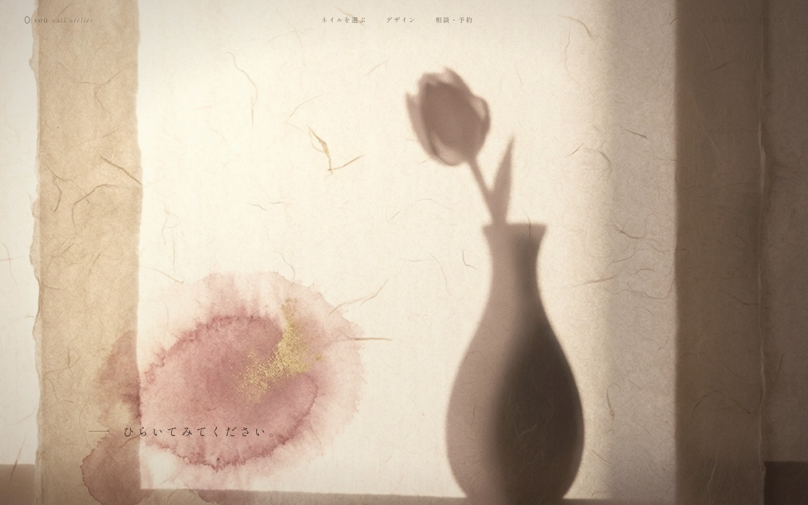 | 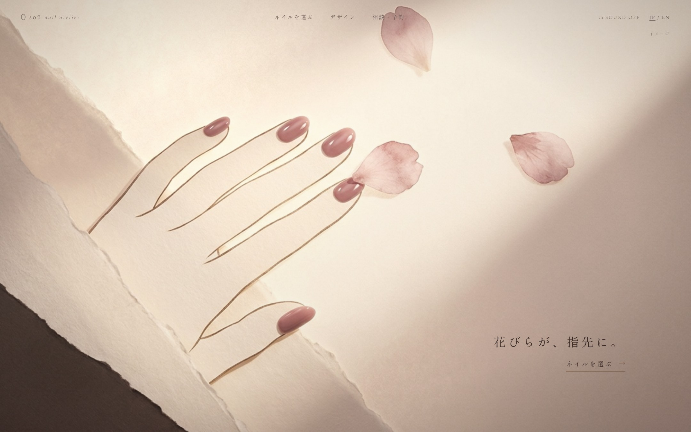 |
| **03 · 定番换款（白磁絵皿）** | **04 · セルフデザイン（試色短冊）** |
| 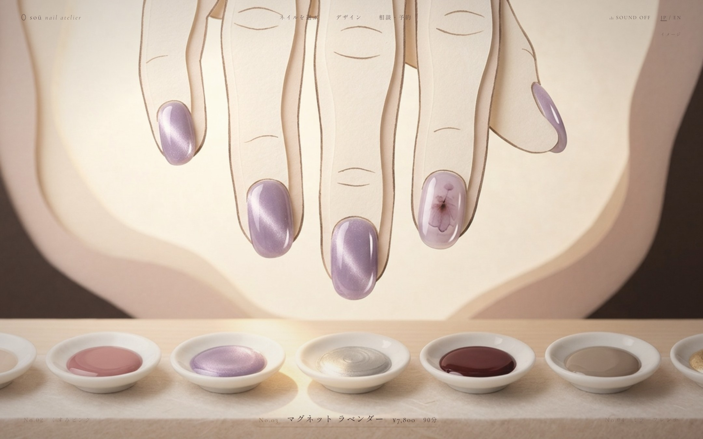 | 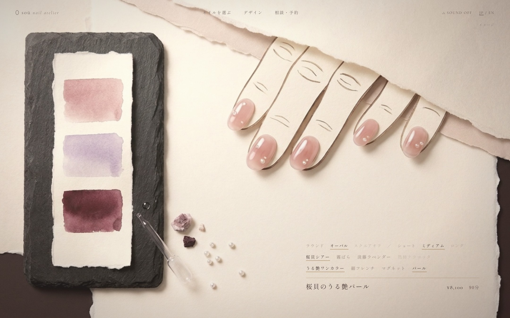 |
| **05 · 设计卡 + オーダーメイド** | **06 · 片尾（折り形手紙・店舗案内）** |
| 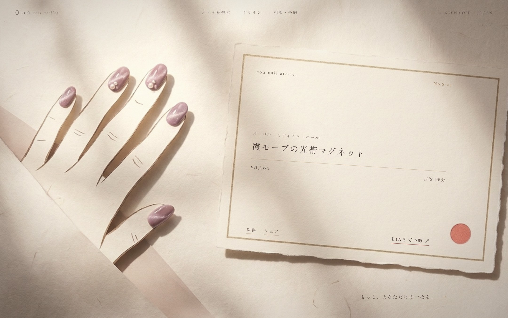 | 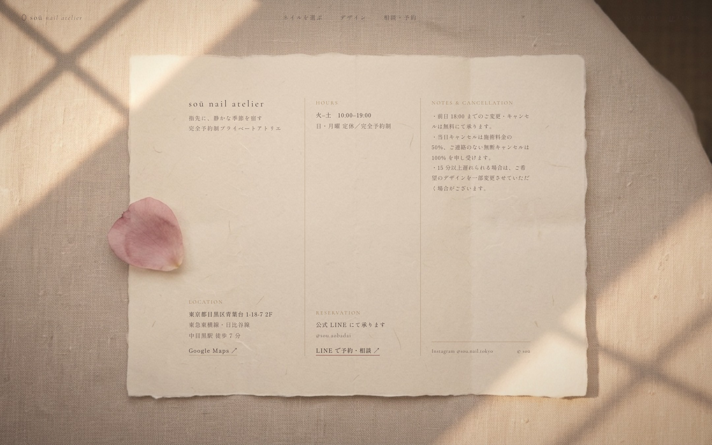 |

### 手机端（375×812 竖屏原生构图）
| 01 · 开场 | 02 · 花瓣落甲 | 03 · 定番换款 |
|---|---|---|
| 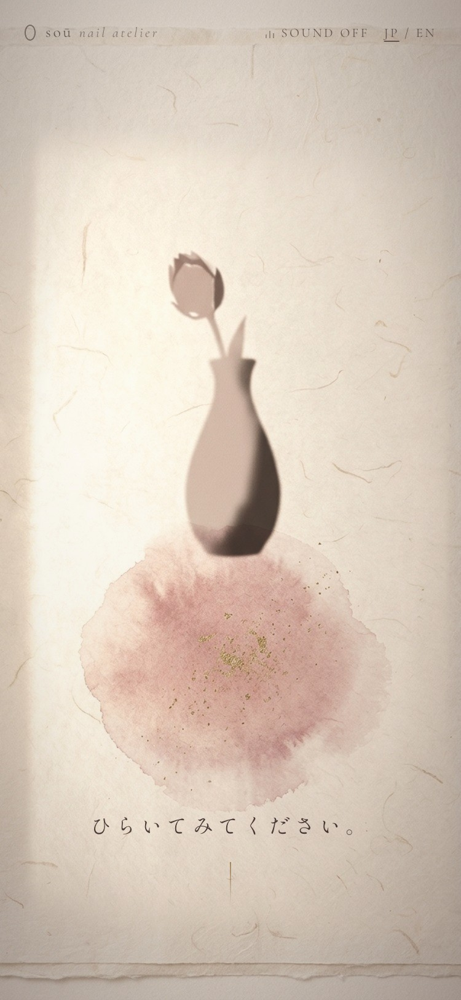 | 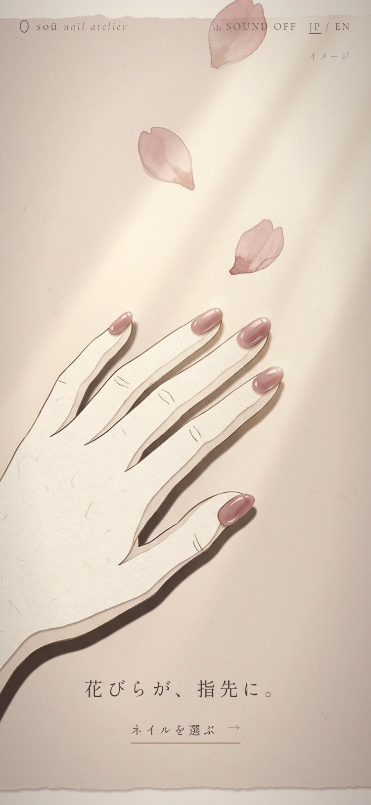 | 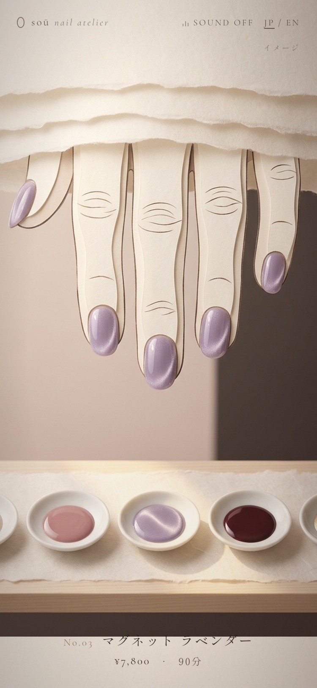 |
| **04 · セルフデザイン** | **05 · 设计卡 + オーダーメイド** | **06 · 片尾（店舗案内）** |
| 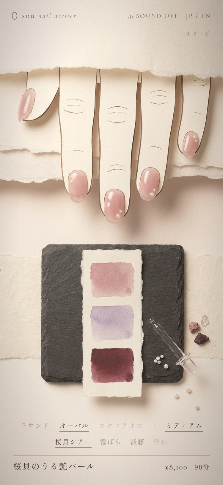 | 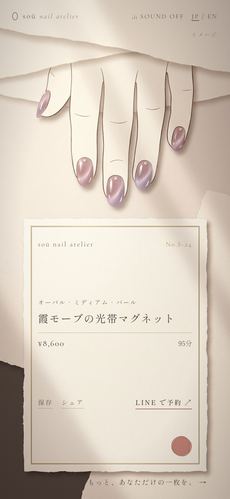 | 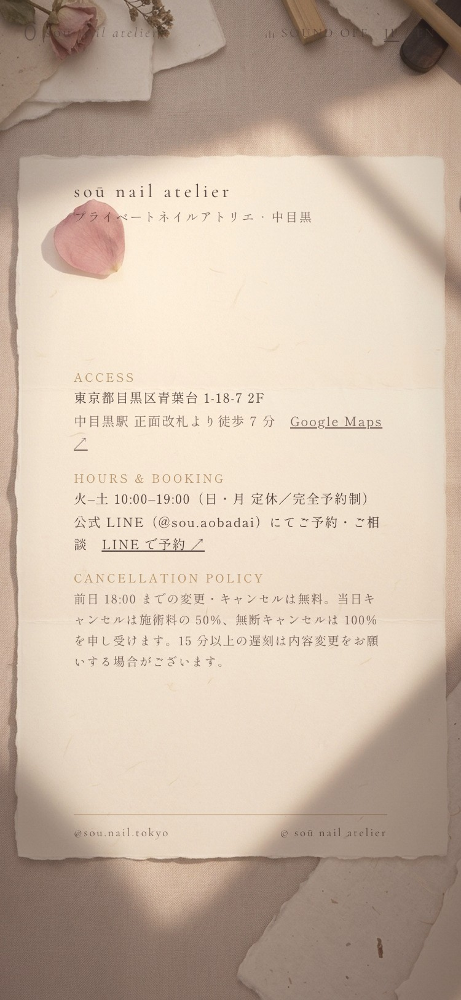 |

---

## 4. 「啊」的瞬间：水彩入纸 → 瞬间凝成玻璃胶面（4 帧连续拆解）

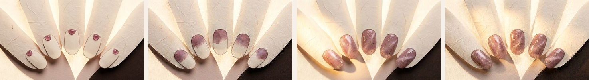

| 帧 1：落滴 | 帧 2：毛细晕染（滲み） | 帧 3：金箔/光粒子浮起 | 帧 4：窗光扫过凝成ちゅるん胶面 |
|---|---|---|---|
| 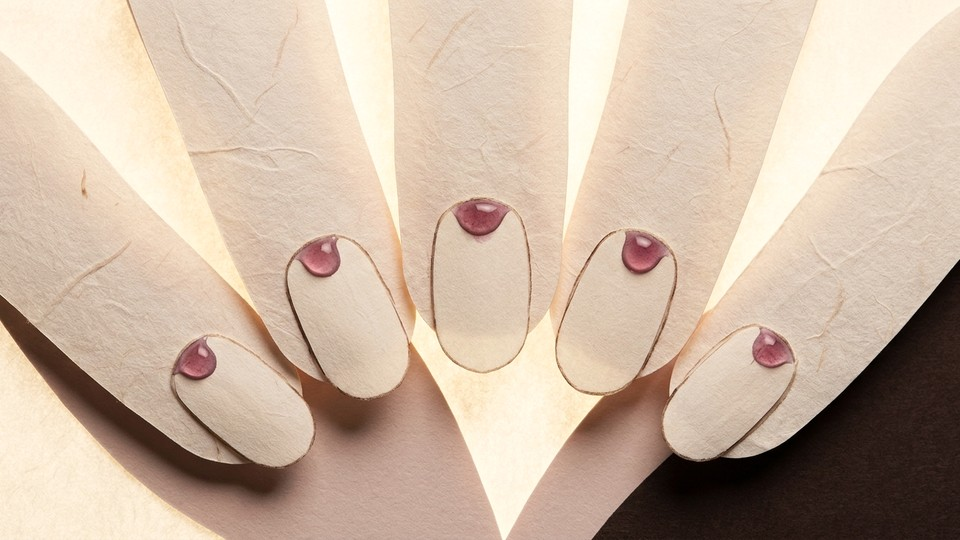 | 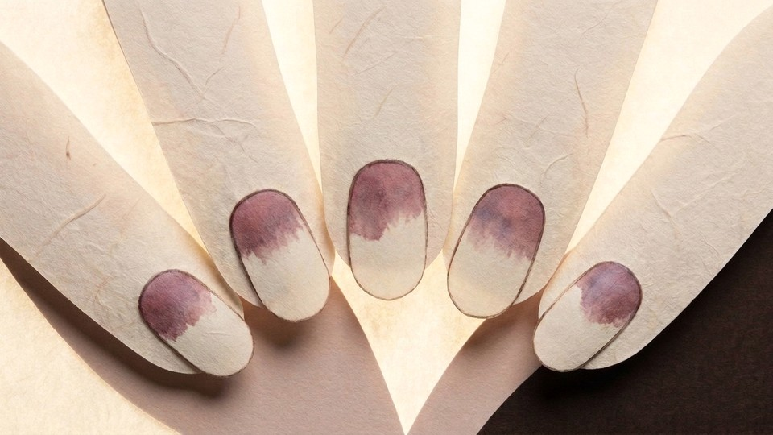 | 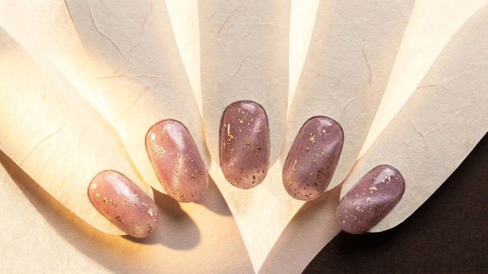 | 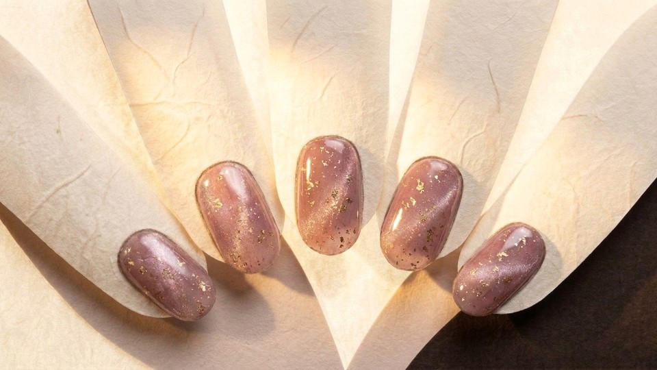 |

1. 客人滑到或轻点某只白磁绘皿（`絵皿`）时，甲根处先落下一滴极清透的水彩原液；
2. 颜料顺着和纸纤维纹理以真实的毛细噪声边缘（WebGL2 Perlin/FBM fiber-bleed shader）向甲尖自然晕开，此时质感还是哑光湿润水彩；
3. 技法纹理（猫眼光带 / 法式细边 / 金箔微粒）在水痕中浮现；
4. 一道暖窗光斜扫过五枚指甲，哑光水痕在 0.35 秒内瞬间"封层固化"，鼓起饱满透亮的 3D 凝胶高光弧面——完成从"纸上画"到"指尖真甲"的惊艳跃迁。

---

## 5. 三档怎么一眼区分（不靠说明文字）
- **定番（12 款）**：窗台木沿上一字排开的 **12 只手捏白磁绘皿（`絵皿`）**，每皿盛着一汪已经调好的饱满色胶。镜头焦点滑过哪只绘皿，指尖就晕染成哪一款。
- **セルフデザイン（中端自选）**：画面切换到右侧一方深色玄昌石砚板，上面放着一条**空白毛边和纸试色短册（`短冊`）与一只透明吹制玻璃水滴器**——完全不同的器物语言。客人每选定甲型、长度、底色、技法、点缀，短册上就向上洇染出一道新的半透明水彩横纹（共 5 层）；轻点短册上任意一道色纹即可直接回退重配。不协调的矿物色片自动退入纸影变淡。
- **オーダーメイド（高端一对一）**：首页与流程中绝不出现；只有在厚越前棉纸设计卡落定之后，纸卡下方的留白处才像墨迹显影般浮现一行小字：「もっと、あなただけの一枚を。」

---

## 6. 信息放在片子里的哪个实物上（全部为真实 HTML 文字）
- **款名 · 价格 · 时长**：以活版压印排版直接印在绘皿/短册下方的**手漉和纸台面留白处**（`No.03 マグネット ラベンダー ¥7,800 · 90分`），不用任何圆角白框。
- **设计卡与 LINE 预约**：印在落在窗光里的**毛边厚越前棉纸订制单**上，右下角一枚朱砂色落款印章即为真实的 `<a>` 链接「LINE で予約」。
- **店铺地址 · 营业时间 · 中目黑交通 · 取消规则**：片尾暮色渐暗时，镜头停在案头一封展开的**日式折形手纸（`折り形手紙`）**上，所有店铺信息与取消规定都作为真实 HTML 段落排印在信笺折痕内，配合页面 `<script type="application/ld+json">` 输出 `NailSalon` 结构化数据。

---

## 7. 声音设计（Web Audio API 极轻材质音，默认静音）
- **开场花影**：极轻微的障子和纸受风微颤声（低通滤波粉红噪声包络，`< 8KB`）。
- **定番切换绘皿**：薄胎白瓷绘皿与桧木台面的极轻触碰声（清脆短促无尾音）+ 水滴入纸的细微毛细吸音。
- **セルフデザイン每选一层**：水彩笔尖轻触干和纸的柔和沙沙声；封层完成时一声极轻的玻璃清鸣。
- **设计卡与信笺展开**：厚棉纸轻轻落定在桌面上的空气摩擦声。

---

## 8. 最大风险与工程解法
- **风险**：如果和纸插画风格做太平面，客人会担心看不清真实美甲做出来的胶感与猫眼/镜面光泽。
- **解法**：严格执行**"环境与手 2.5D 纸艺化，但五枚甲面区域采用高动态范围实拍技法层 + WebGL2 法线高光着色器"**——手越素雅留白，五枚甲面的水润ちゅるん光泽、猫眼磁粉流动与珍珠立体感反而比全写实照片突出 3 倍，且首屏仅需一张轻量 WebP + `< 15KB` 原生着色器，轻松稳跑 60fps。
