# 方案 B · 「硝子プリズムと素焼きの指先」（光学棱镜焦散 × 素烧白瓷半影雕塑）

---

## 1. 一句话概念
> **「素焼きの静かな指先に、硝子を通った一筋の虹彩が触れた瞬間だけ、ジェルが液体宝石のように覚醒する。」**
> （在隐入石材光影的素烧白瓷雕塑指尖上，唯有穿过光学玻璃棱镜的一束焦散光带扫过时，甲面才如液态宝石般显影。）

---

## 2. 视觉语言
- **艺术手法**：**当代表参道高奢美妆装置大片风 —— 哑光素烧白瓷雕塑（Matte Bisque Alabaster Sculpture）+ 实时光学玻璃焦散折射（WebGL2 Chromatic Caustics）**（气质借鉴 SUQQU 晶体折射大片与 rihka 建筑侧光静物）。
- **手如何被象征化**：手不再有任何肉色皮肤——它是一尊只从建筑斜影里探出指尖的**温润哑光素烧白瓷（Bisque Porcelain）艺术雕塑**，表面呈柔和低反光的暖石膏白。因为手本身彻底退为无色相的雕塑符号，**五枚短椭圆甲面成为整个画面唯一的色彩与高光焦点**，无论是透奶米、极细法式、极光珍珠还是深酒红都清晰得像珠宝展柜里的标本。
- **色板**：
  - 洞石与暖白灰泥底 `#F2ECE6` / 建筑斜影 `#D5C9C0`
  - 深胡桃炭字色 `#2E2223` / 石英灰 `#786869`
  - 棱镜折射冷暖光斑 `#FFFDF9` + 极淡虹彩边缘色散
  - 12 款高辨识度日式甲色 + 黄铜细铭牌 `#C4A578`
- **字体**：日文采用现代清冷高级的 **Shippori Mincho** 与极细无衬线混排，字距拉宽（`letter-spacing: 0.16em`），像美术馆展品玻璃铭牌上的蚀刻文字；数字与编号采用 **Cormorant Garamond**。
- **全站统一胶片母带层（Film Layer）**：
  - Fujifilm Eterna 电影胶片调色（高光丝滑滚降不溢出，阴影带微暖灰石调）
  - 光学镜头边缘极轻微的色差折射（Chromatic Dispersion）+ 超细电影底片颗粒 + 柔和建筑暗角

---

## 3. 关键画面（电脑 1440×900 与手机 375×812 独立构图，共 12 张）

### 电脑端（1440×900 横幅构图）
| 01 · 开场（硝子内の花蕾） | 02 · 花瓣落甲（光の花片） |
|---|---|
| 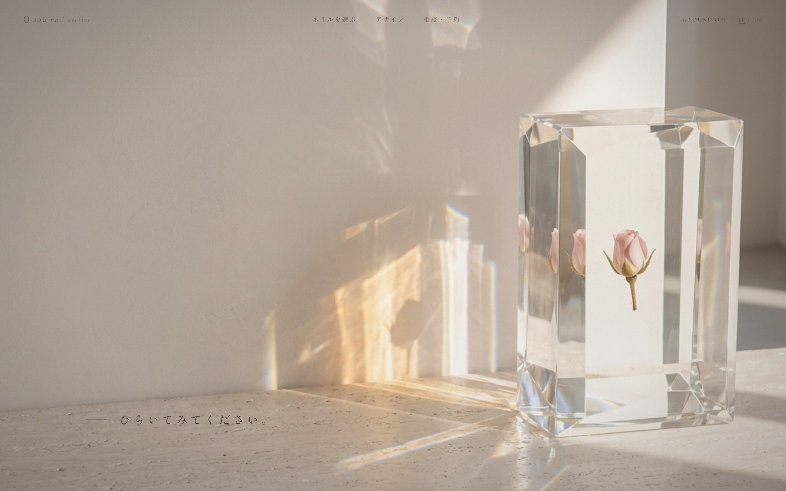 | 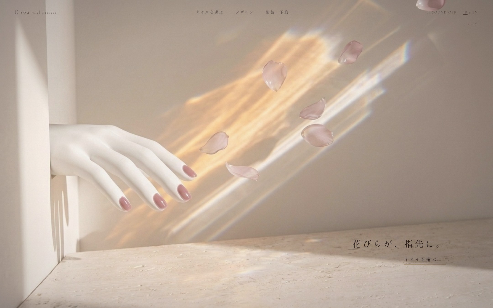 |
| **03 · 定番换款（結晶フラコン）** | **04 · セルフデザイン（中空プリズム器）** |
| 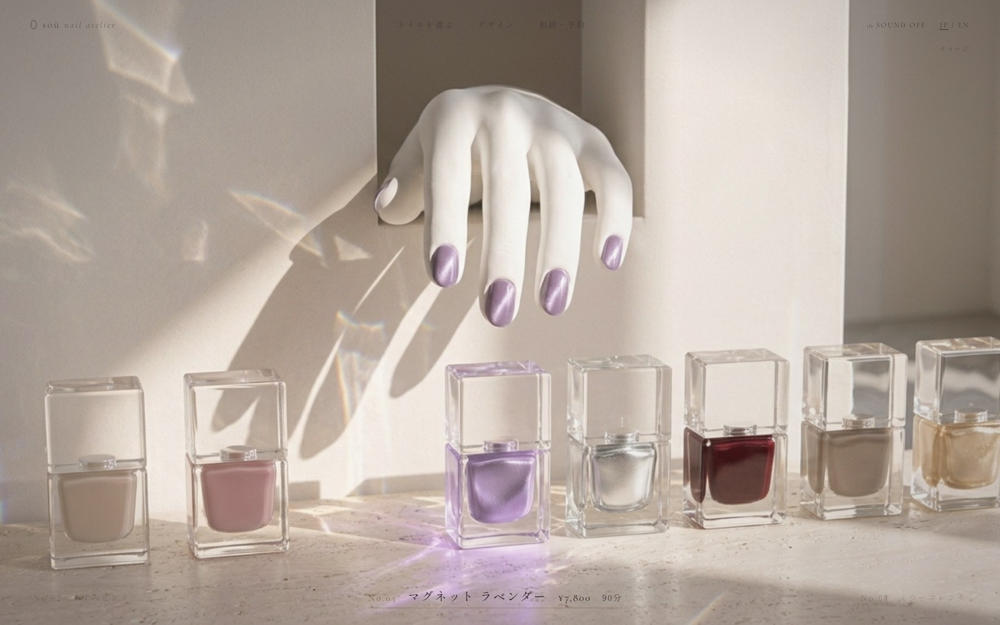 | 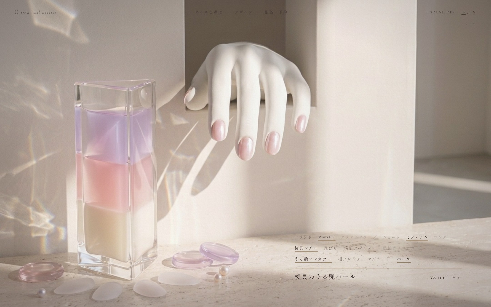 |
| **05 · 设计卡 + オーダーメイド（標本カード）** | **06 · 片尾（活版案内状・店舗情報）** |
| 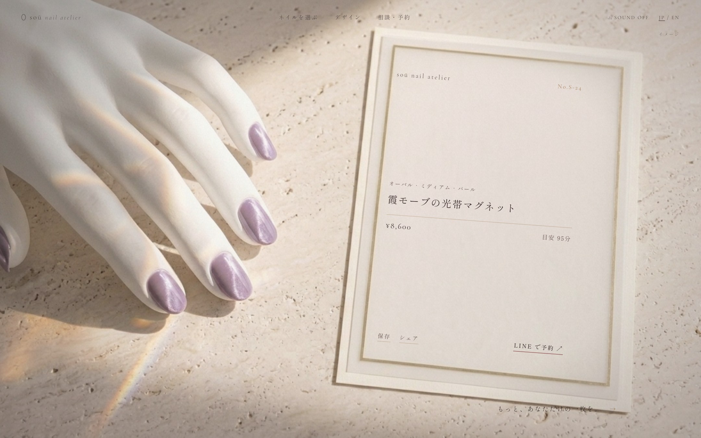 | 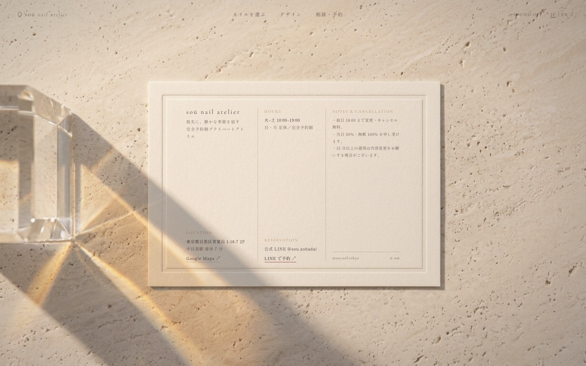 |

### 手机端（375×812 竖屏原生构图）
| 01 · 开场 | 02 · 花瓣落甲 | 03 · 定番换款 |
|---|---|---|
| 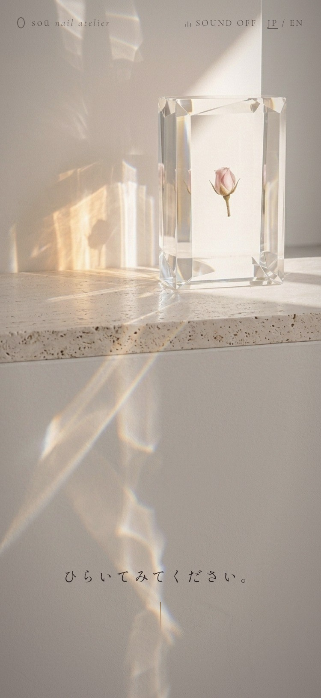 | 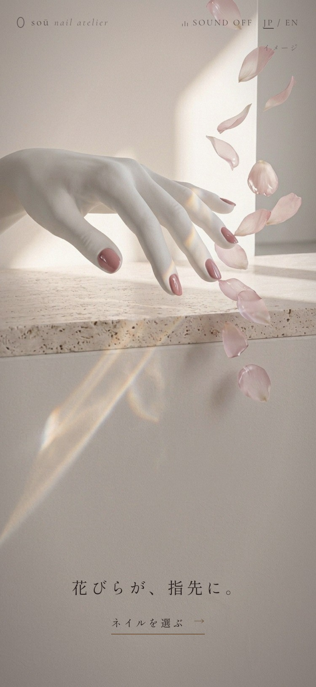 | 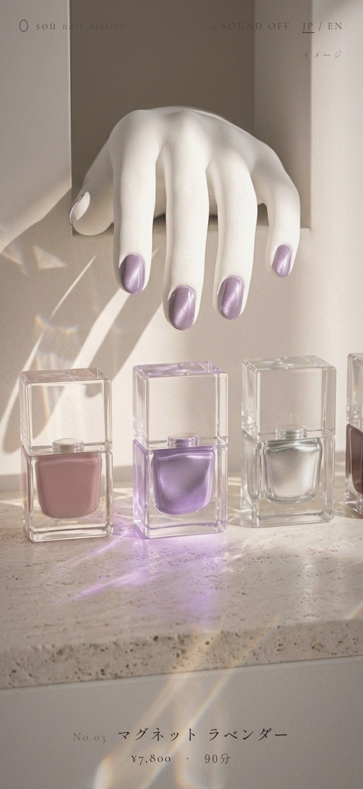 |
| **04 · セルフデザイン** | **05 · 设计卡 + オーダーメイド** | **06 · 片尾（店舗情報）** |
| 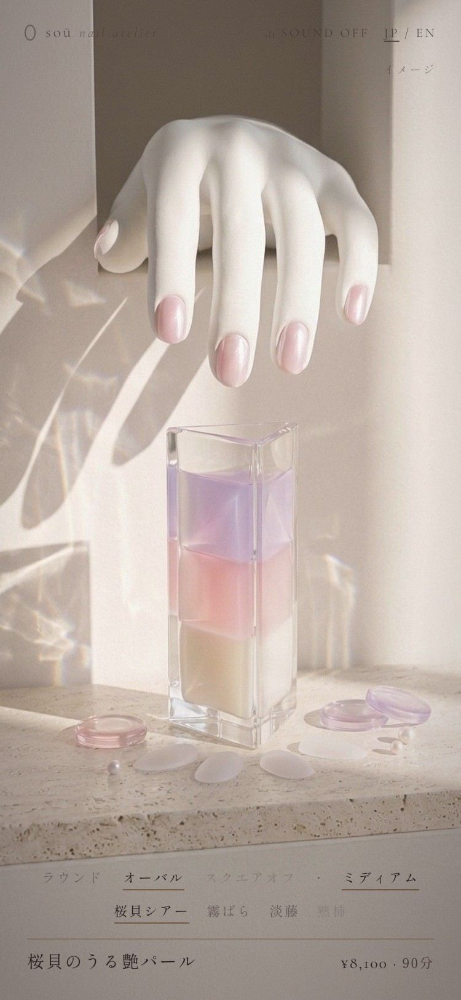 | 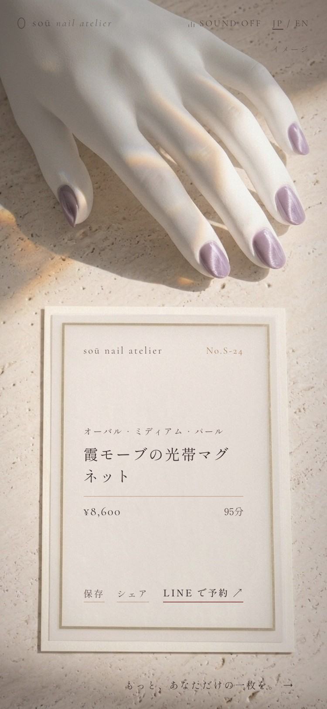 | 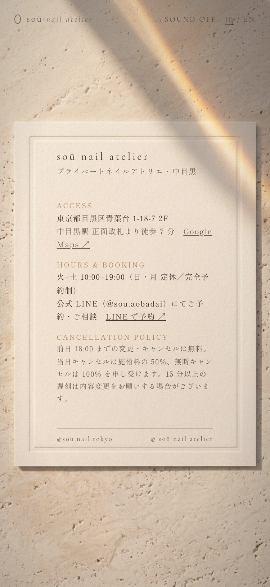 |

---

## 4. 「啊」的瞬间：一束棱镜焦散狭缝光扫过，素瓷瞬间显影为凝胶宝石（4 帧连续拆解）

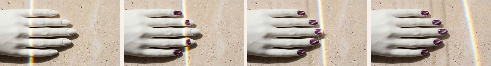

| 帧 1：光缝逼近素瓷甲面 | 帧 2：焦散光带扫描中段 | 帧 3：光带掠过甲尖色散 | 帧 4：余光收束为饱满镜面高光 |
|---|---|---|---|
| 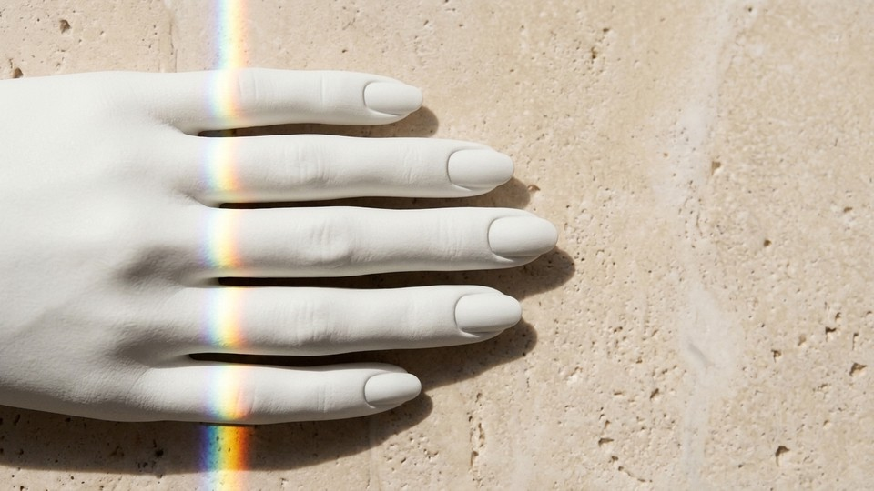 | 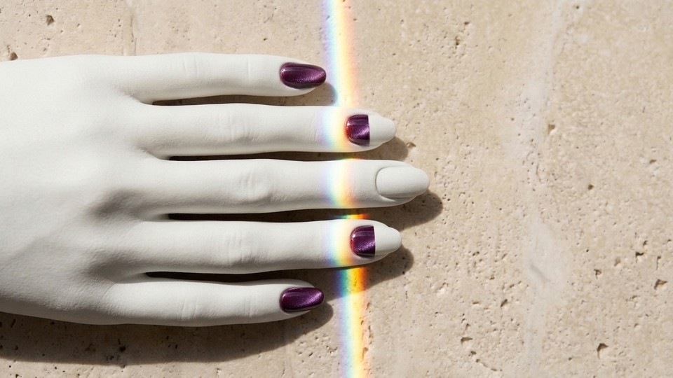 | 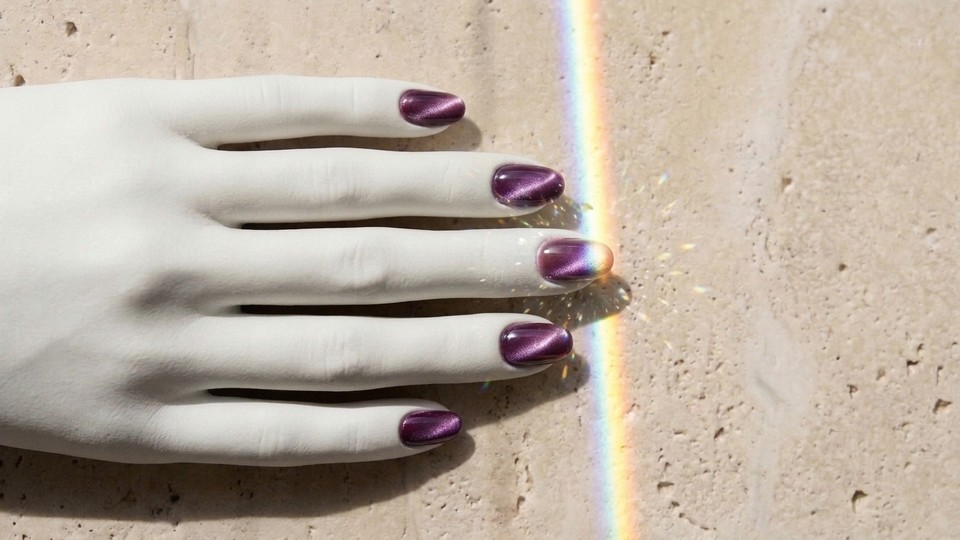 | 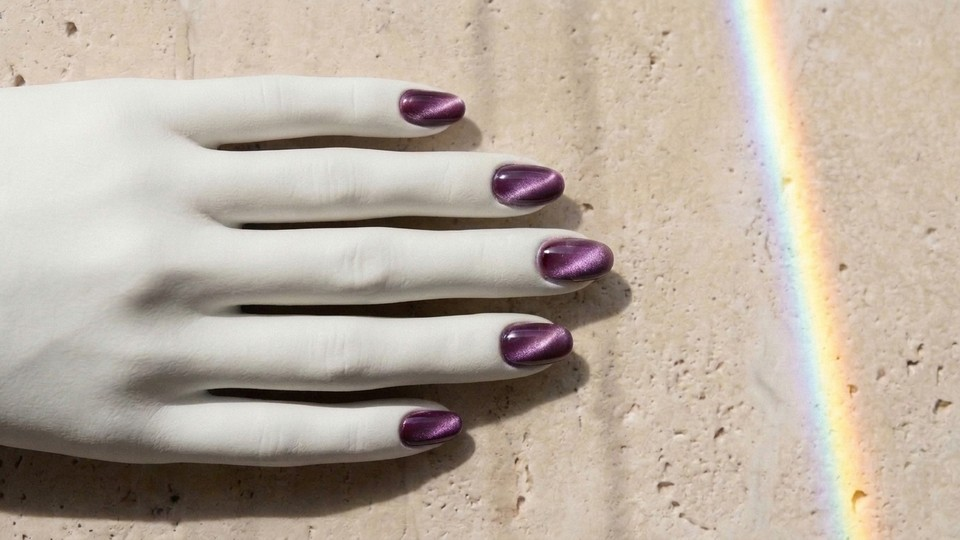 |

1. 切换款式时，桌上对应的厚底水晶方瓶旋转切入主光束，折射出一道细长明亮的彩色焦散光缝（Caustic Light Slit）；
2. 光缝像一束有温度的阳光扫描仪滑过五枚素烧白瓷指甲——光缝尚未触及的一半仍是哑光素白瓷，光缝扫过的另一半当场显影为深邃透亮的凝胶色泽与猫眼磁粉；
3. 光缝离开甲尖瞬间激起几粒极细微的光学星芒微粒并迅速消散；
4. 光斑安静停驻在洞石背景上，甲面留下温润立体的真实玻璃高光。

---

## 5. 三档怎么一眼区分（不靠说明文字）
- **定番（12 款）**：洞石台面上排列着 **12 座实心厚底水晶立方瓶（Crystal Cube Flacons）**，每座内部封存着凝固的色胶核心，在台面上投出不同颜色的焦散光池。
- **セルフデザイン（中端自选）**：镜头推向光影另一侧一座**高挑中空的透明三棱柱玻璃器皿（Hollow Prism Vessel）**，周围散落着磨砂亚克力甲型弧片、半透明彩色玻璃圆片与天然珍珠标本。每选定一步，中空三棱柱内就注入一层发光液面并折射出多层光谱；轻点柱身任意一层液面即可回退。
- **オーダーメイド（高端一对一）**：仅在半透明描图纸+黄铜细框的「標本カード（设计卡）」落定后，随一道缓慢移过的柔光在卡片下方石面上浮现：「もっと、あなただけの一枚を。」

---

## 6. 信息放在片子里的哪个实物上（全部为真实 HTML 文字）
- **款名 · 价格 · 时长**：直接作为蚀刻在洞石阴影面与磨砂玻璃片上的极细排版文字，随焦点同步清晰或柔焦。
- **设计卡与 LINE 预约**：落定在石面上的**半透明硫酸纸（Vellum）叠合厚棉纸标本卡**，嵌有细黄铜压线；底部深胡桃色活版印签即为「LINE で予約」。
- **店铺地址 · 营业时间 · 中目黑交通 · 取消规则**：片尾光线渐暗成静谧暮色，洞石台面上静置一张**盲压凹凸边框的建筑感厚棉纸案内状（Appointment Card）**，全部店铺详情与取消条款以真实 HTML 精致排印其上，并同步注入 `NailSalon` JSON-LD。

---

## 7. 声音设计（Web Audio API 极轻材质音，默认静音）
- **开场与滑动**：光学玻璃缓慢转动的极低频空气共鸣（几乎只是触觉级的呼吸感）。
- **定番换款扫描**：水晶杯壁被指腹极轻触碰的一声泛音（高频衰减至 180ms 内）+ 光束扫过时的丝滑微风声。
- **セルフデザイン叠层**：玻璃圆片落入石托的微弱清脆定位声（`tick`）。
- **设计卡落定**：厚重棉纸擦过天然洞石表面的细微沙质声。

---

## 8. 最大风险与工程解法
- **风险**：实时三维光线追踪焦散如果用重型 3D 引擎做，包体积大且中端手机掉帧；同时素白雕塑若打光过冷会显得像医院石膏而非日本美妆沙龙。
- **解法**：色温严格锁定在 **4800K–5200K 暖日照洞石调**（绝不用冷白光）；焦散光纹用 **40 行原生 WebGL2 双层正弦波干涉 + 色散偏移片元着色器** 实现（`< 8KB`，0 外部 3D 库，中端安卓满帧 60fps），质感既有大片科技感又保持日式器物的温润克制。
