# 方案 C · 「夕霞の琥珀と流体ラッカー」（暖暮逆光丝绒剪影 × 微距流体琥珀丝带）

---

## 1. 一句话概念
> **「夕霞の深い陰翳のなかで、とろりとした琥珀と薔薇色の流体リボンが指先を包み、一粒の艶へと溶けあう。」**
> （在暖暮深棕与灰粉交织的逆光阴翳里，浓稠如蜜的琥珀与玫瑰流体丝带轻绕指尖，融凝成五枚发光的甲面。）

---

## 2. 视觉语言
- **艺术手法**：**高奢彩妆电视广告片风 —— 暖暮明暗对照逆光剪影（Warm Dusk Chiaroscuro Silhouette）+ 微距粘性流体漆艺丝带（Macro Fluid Lacquer Ribbons）+ 香槟金微尘（Bokeh Dust）**（气质借鉴 THREE 烟熏棕粉感性大片与 OSAJI 暗调文学肖像，直接唤醒品牌色板中最迷人的深棕玫瑰木 `#2A1D1F` 与灰粉 `#C9989A`）。
- **手如何被象征化**：手完全处在**逆光暖金轮廓光（Rim Light）勾勒出的柔焦暗部剪影**之中，伴随半透明欧根纱微影，内部细节隐入温柔的深玫瑰木色（`#2A1D1F`）暮色里，彻底杜绝写实皮肤的生硬与怪异；而在逆光焦点处，**五枚短椭圆甲面与空中漂浮的液态凝胶丝带**被夕阳照得通体透亮，呈现出令人垂涎的"とろみ（浓稠蜜感）"与猫眼丝绒流光。
- **色板**：
  - 暖暮深玫瑰木底 `#2A1D1F` → 晚霞灰粉雾渐变 `#C9989A` / `#7E6B6C`
  - 暖象牙文字与高光 `#F7F1EE` / 柔粉次级字 `#E6D5D0`
  - 香槟金微粒与细金线 `#C7A97F`
  - 液态甲色在深暖底上拥有极高的珠宝级对比度与显色度
- **字体**：暖象牙色 **Shippori Mincho** 细明朝体搭配 **Cormorant Garamond** 金色编号，在暖暮暗底上如电影片头字幕般悬浮呼吸，自带银幕叙事感。
- **全站统一胶片母带层（Film Layer）**：
  - 35mm 柯达 Vision3 500T 暖钨丝/夕阳胶片曲线（暗部呈温润可可紫棕 `#2A1D1F`，高光带轻微柔光漫射 Halation 光晕）
  - 细腻电影胶片颗粒 + 浅景深散景光斑 + 深丝绒暖暗角

---

## 3. 关键画面（电脑 1440×900 与手机 375×812 独立构图，共 12 张）

### 电脑端（1440×900 横幅构图）
| 01 · 开场（夕霞の花影と金塵） | 02 · 花瓣落甲（花片から蜜ジェルへ） |
|---|---|
| 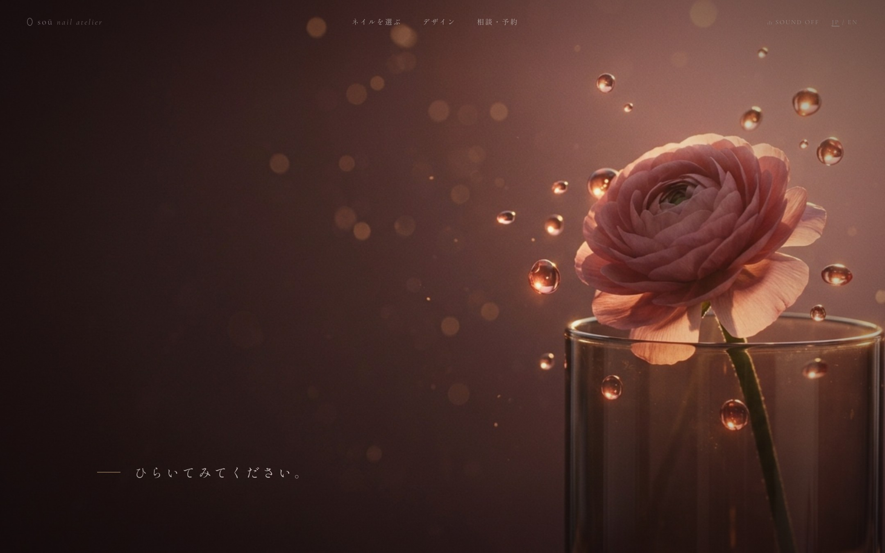 | 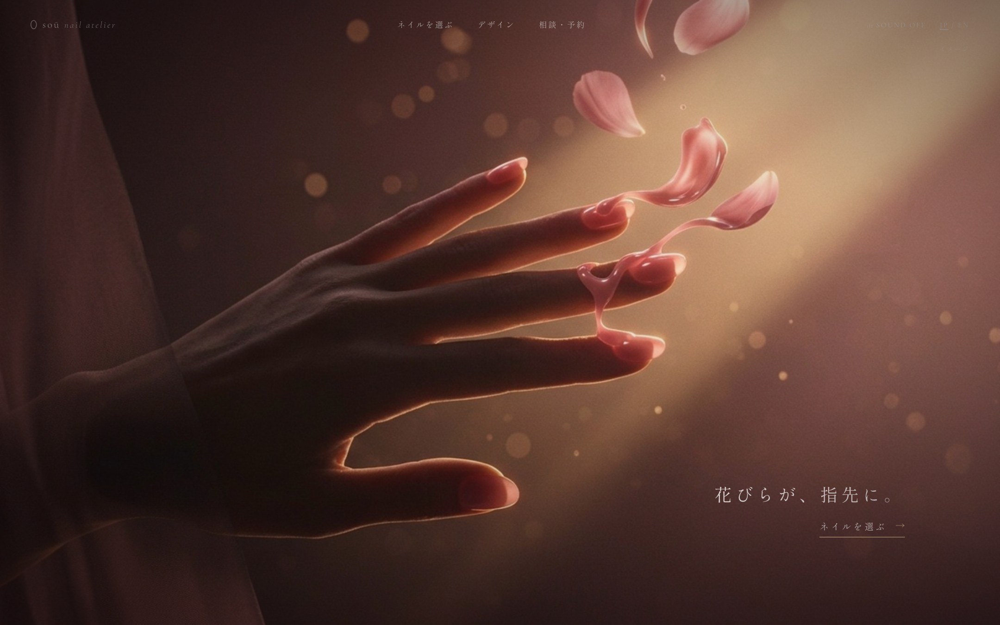 |
| **03 · 定番换款（浮遊する漆滴ボトル）** | **04 · セルフデザイン（琥珀層の調香瓶）** |
| 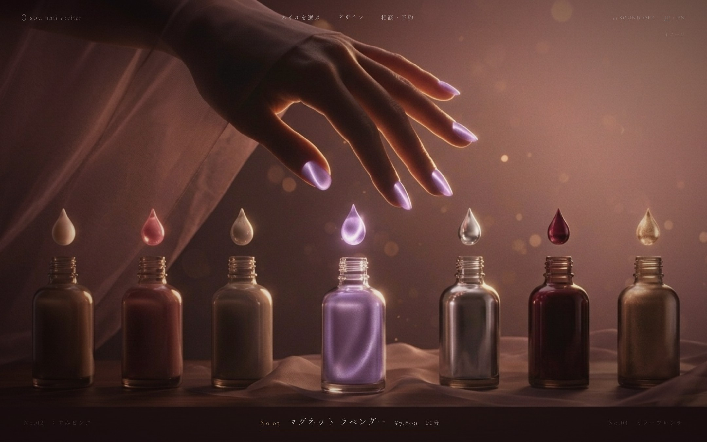 | 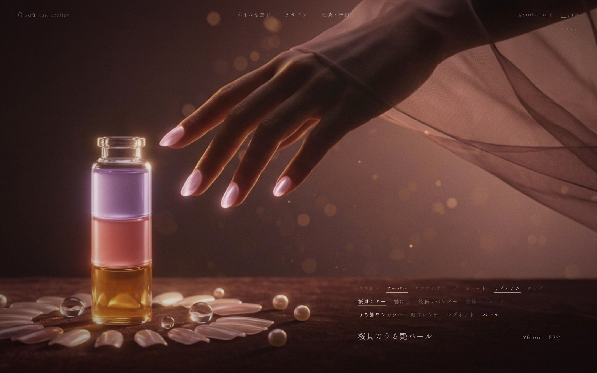 |
| **05 · 设计卡 + オーダーメイド（金縁黒檀・和紙カード）** | **06 · 片尾（封蝋の手紙・店舗案内）** |
| 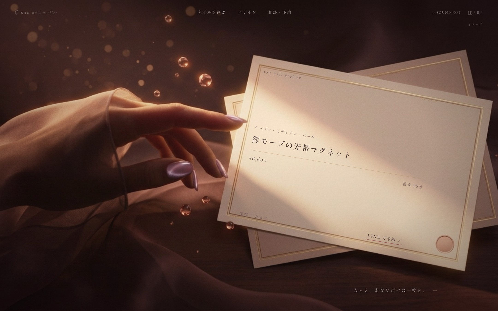 | 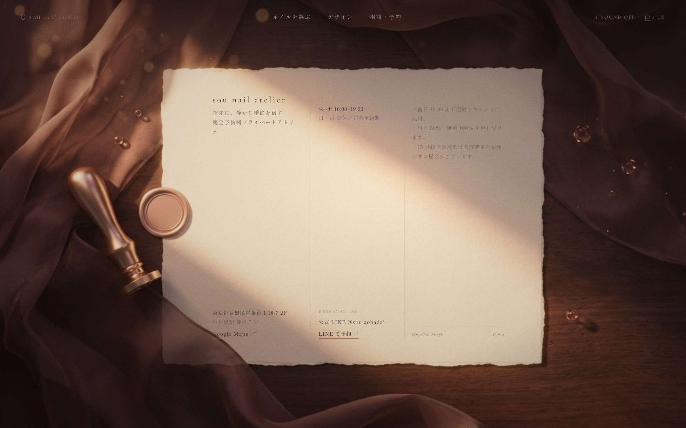 |

### 手机端（375×812 竖屏原生构图）
| 01 · 开场 | 02 · 花瓣落甲 | 03 · 定番换款 |
|---|---|---|
| 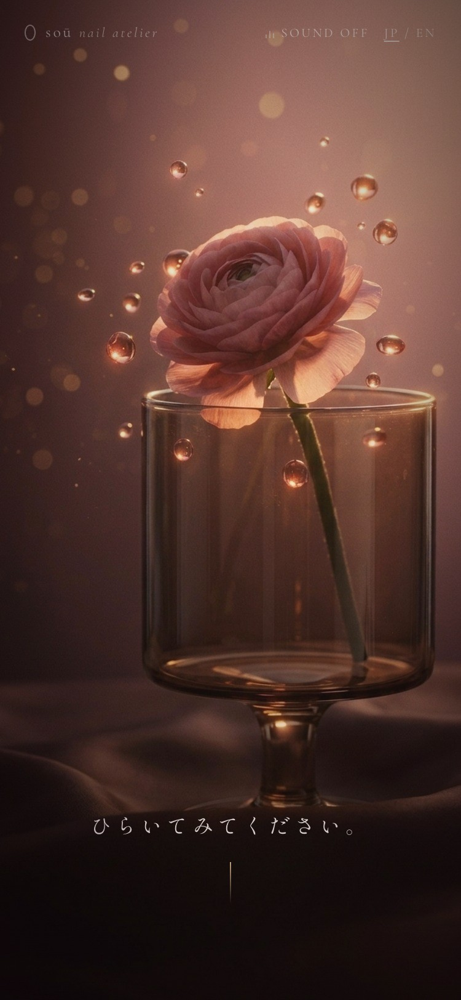 | 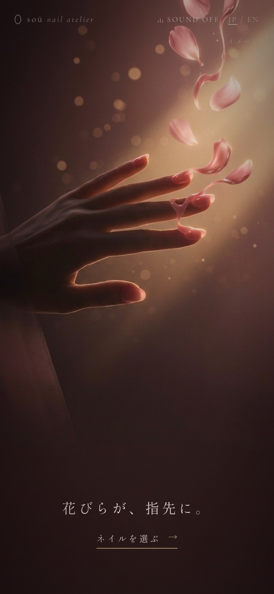 | 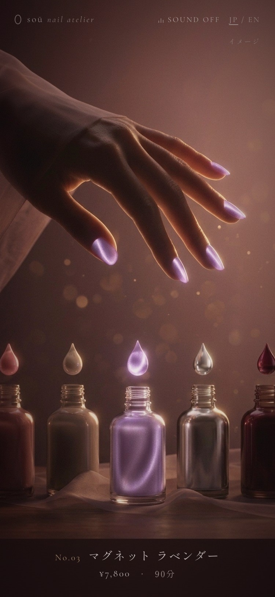 |
| **04 · セルフデザイン** | **05 · 设计卡 + オーダーメイド** | **06 · 片尾（店舗案内）** |
| 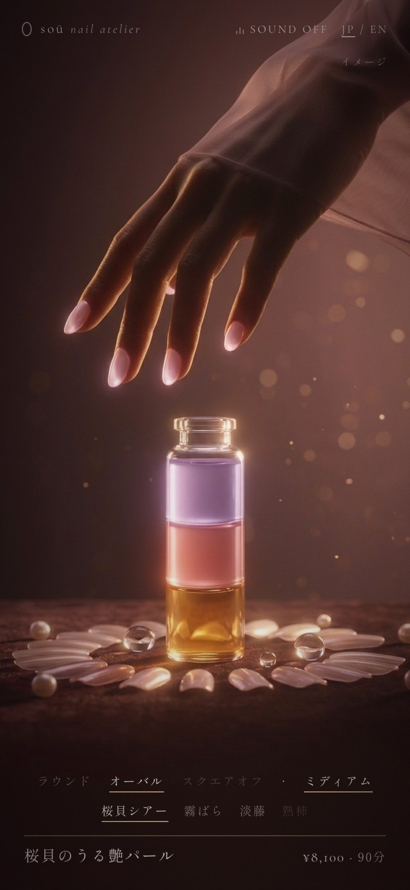 | 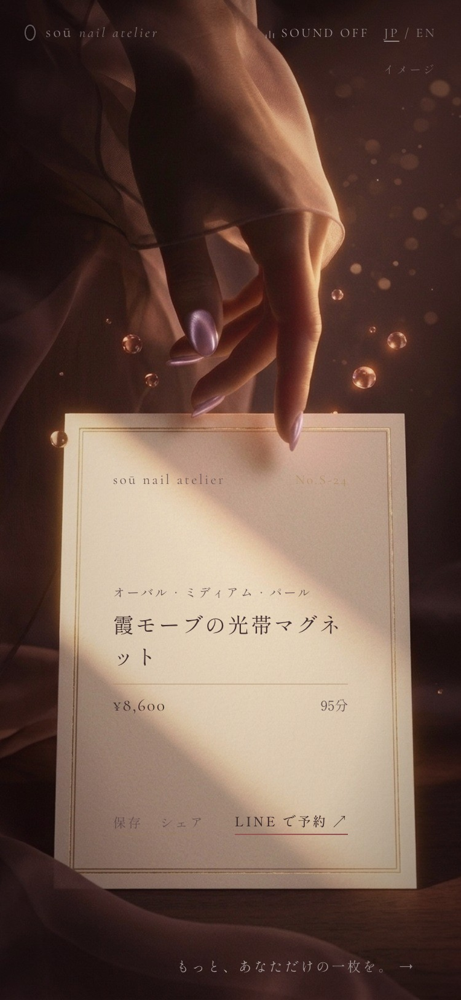 | 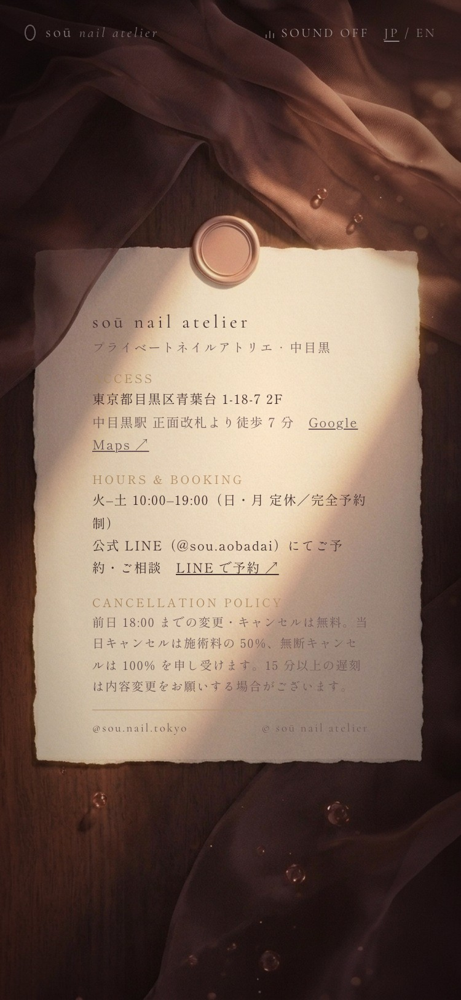 |

---

## 4. 「啊」的瞬间：液态丝带从暗处流淌裹住指尖，收束成镜面凝胶（4 帧连续拆解）

| 帧 1：液态色带自瓶口牵引而出 | 帧 2：浓稠丝带轻柔旋绕五指 | 帧 3：表面张力自然收拢贴合甲床 | 帧 4：金尘掠过凝结成饱满艶甲 |
|---|---|---|---|
|  | 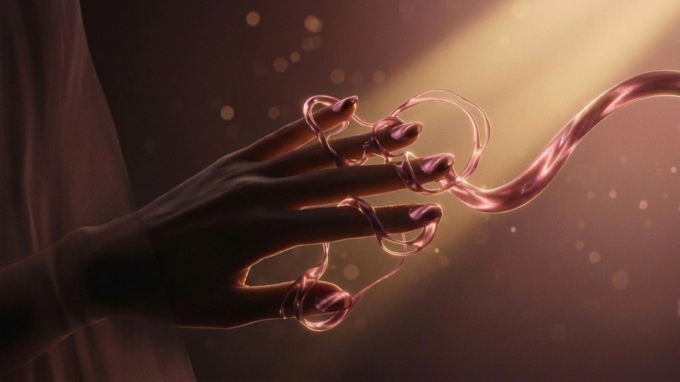 |  |  |

1. 选中一款茶色/烟熏玻璃甲油瓶时，一缕如温热蜂蜜般丝滑的彩色凝胶流体从前景浅景深处柔和升起；
2. 流体丝带顺着逆光轮廓滑向五枚指尖，与甲面的短椭圆弧线形成完美的形状与色彩匹配剪辑（Match Cut）；
3. 依靠液体表面张力，流体自动收拢进甲床边界，绝不外溢，内部浮现猫眼丝绒光带或玳瑁琥珀纹理；
4. 一缕暖霞金光擦过甲面边缘（Halation 微光晕），瞬间定格为深邃水润的成品美甲。

---

## 5. 三档怎么一眼区分（不靠说明文字）
- **定番（12 款）**：暖暮光束中立在深色胡桃木与丝纱台面上的 **12 只烟熏琥珀圆肩小瓶**，每只瓶口上方悬浮着一滴饱满发光的同色液珠（Liquid Droplet），滑动对焦到哪颗液珠，它便化作丝带流向指尖。
- **セルフデザイン（中端自选）**：镜头推向一尊被侧逆光点亮的**透明纤长调香量瓶（ Atelier Apothecary Vial）**，台面上陈列着黑丝绒托盘里的扇形甲片、琉璃色滴与金箔珍珠。客人每选定一层，透明调香瓶内便缓缓沉入一层不同密度的发光琥珀色液层（层与层之间有柔和液面弯月面）；点击任意液层即可回退。
- **オーダーメイド（高端一对一）**：仅在暖象牙金边订制卡从暗影滑入逆光光斑之后，卡片下方暮色里才缓缓亮起细明朝金字：「もっと、あなただけの一枚を。」

---

## 6. 信息放在片子里的哪个实物上（全部为真实 HTML 文字）
- **款名 · 价格 · 时长**：如银幕左下/中央下方的电影胶片字幕，以暖象牙色极细明朝体直接融在暗部留白里，零背景框。
- **设计卡与 LINE 预约**：一张落在最后一束夕阳斜光里的**重磅暖象牙棉纸烫金订制单**（与深暖暮背景形成极具戏剧感的明暗对比，让人一眼想截图保存！），卡面火漆金印处即为「LINE で予約」。
- **店铺地址 · 营业时间 · 中目黑交通 · 取消规则**：片尾一封带有哑光玫瑰金封蜡的**暮色信封与展开内页信笺**，暖光聚焦在信笺纸面上，清晰排印地址、营业时间、中目黑站步行指引与取消规则，全部为真实 HTML 文本并附 `NailSalon` JSON-LD。

---

## 7. 声音设计（Web Audio API 极轻材质音，默认静音）
- **开场**：极柔和的丝绸欧根纱拂过空气的微息声。
- **定番流体换款**：浓稠液体轻柔涌动的低频温润水音（绝非哗啦水声，而是蜂蜜/精油般克制的阻尼感）+ 凝结瞬间极轻的金属音叉余韵。
- **セルフデザイン注层**：精油滴入玻璃管壁的干净单音滴落声。
- **设计卡与片尾**：厚信封纸滑出与火漆轻叩木面的沉稳微响。

---

## 8. 最大风险与工程解法
- **风险**：如果暗调控制不好容易变成欧美科技黑金风，或者浅色甲（如 `01 ちゅるんミルクベージュ`、`05 極細フレンチ`）在暗光下显脏。
- **解法**：背景绝不用冷黑（`#000`），严格使用品牌色板中的**暖玫瑰木棕 `#2A1D1F` 叠合 `#C9989A` 夕霞柔光斜投**，并在指尖位置固定打一束 5000K 清透暖白窗边逆光——让浅奶米色和极细白法式在深暖背景衬托下反而像发光贝母一样通透干净；流体丝带采用 WebGL2 2D 有向距离场（SDF Metaball Ribbon + MatCap 高光）渲染，体积 `< 12KB` 且稳跑 60fps。
