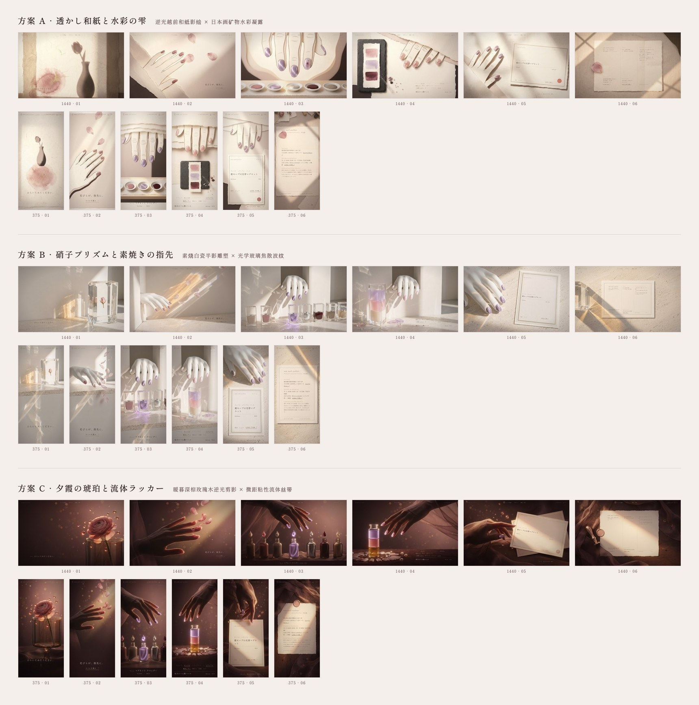

# soū nail atelier · v5 第 1 阶段创意提案总览（A / B / C 三方案对比与推荐）

> 本目录为 `docs/v5-execute.md` 第 1 阶段交付物（**只验证创意方向与最终网站画面完成度，尚未修改正式网站代码**）。
> 行业参考调研详见：[`research.md`](./research.md)（含 10 家日本高端美甲沙龙与美妆品牌实截与拆解）。

---

## 1. 全景缩略自检图（3 方案 × 12 帧 = 36 帧同屏对比）

- **横向看同一行**：每个方案内部的 12 张画面（电脑 1440×900 × 6 + 手机 375×812 独立构图 × 6）共享完全一致的光源色温、手部符号语言、统一胶片调色与细颗粒，没有任何元素像外贴控件。
- **纵向看三行之间**：即使缩到极小尺寸，**方案 A（逆光手漉和纸影绘 × 水彩凝露）**、**方案 B（素烧白瓷半影雕塑 × 光学棱镜焦散）**、**方案 C（暖暮玫瑰木逆光剪影 × 微距流体琥珀）** 在世界观、明暗调性与材质语言上也一眼立判。

---

## 2. 三个方案并排对比表

| 维度 | [方案 A · 透かし和紙と水彩の雫](./A/README.md) | [方案 B · 硝子プリズムと素焼きの指先](./B/README.md) | [方案 C · 夕霞の琥珀と流体ラッカー](./C/README.md) |
|---|---|---|---|
| **一句话概念** | 透过手漉和纸摇曳的花影与淡墨手影间，五枚短甲如未干的矿物水彩凝露般立体发光 | 隐入洞石斜影的素烧白瓷雕塑指尖上，棱镜焦散光缝扫过瞬间，甲面如液态宝石般显影 | 暖暮深棕与灰粉交织的逆光阴翳里，浓稠如蜜的琥珀玫瑰流体丝带轻绕指尖融凝成甲 |
| **核心艺术手法** | 2.5D 逆光层叠越前和纸剪影剧场 + 日本画水彩毛细晕染（Nijimi）+ 3D 高光胶面 | 哑光素烧白瓷雕塑半影 + 原生 WebGL2 光学玻璃焦散波纹与微色散光带 | 35mm 暖暮明暗对照逆光剪影 + 微距粘性流体漆艺丝带（SDF Ribbon）+ 散景金尘 |
| **手如何去 AI 化** | 撕边手漉和纸剪影 + 极细暖墨勾线（零毛孔、零真皮肉感） | 哑光暖白素烧瓷器雕塑指尖（彻底剥离肤色干扰，甲色 100% 纯净） | 柔焦暖金轮廓光剪影隐入深玫瑰木暮色（只见优雅轮廓与发光甲面） |
| **「啊」的换款瞬间** | 一滴水彩落入干和纸毛细晕开 → 窗光扫过瞬间"封层固化"鼓起玻璃胶面 | 水晶方瓶折射一道彩色焦散狭缝光扫过素瓷甲面，所到之处实时显影为宝石色胶 | 瓶口液珠牵引出温润流体丝带旋绕指尖，借表面张力收拢进甲床并掠过金尘微光 |
| **定番 vs セルフデザイン入口区分** | **12 只白磁绘皿（`絵皿`）** vs **玄昌石砚板上的空白毛边试色短册（`短冊`）+ 水滴器** | **12 座实心水晶方瓶** vs **中空透明三棱柱玻璃器皿 + 磨砂亚克力/色片标本** | **12 只悬浮液珠的烟熏圆肩瓶** vs **侧逆光透明纤长调香量瓶（液层逐层沉降）** |
| **实物化信息载体（真实 HTML 文字）** | 活版压印在和纸台面、越前棉纸朱印订制卡、三折式日式**折形手纸（`折り形手紙`）** | 洞石阴影与磨砂玻璃蚀刻字、描图纸黄铜框**标本卡**、盲压凹凸**建筑感案内状** | 银幕式暖象牙明朝体字幕、斜光重磅**烫金棉纸卡**、玫瑰金**火漆封蜡暮色信笺** |
| **声音质感（Web Audio）** | 障子和纸微颤、薄胎白瓷轻碰、水滴入纸毛细声、干笔沙沙声 | 光学玻璃低频空气共鸣、水晶杯壁清脆短泛音、石托定位轻响 | 欧根纱微息、浓稠蜜感流体阻尼低音、精油滴管单音、火漆轻叩木面 |
| **气质参考溯源** | BAUM（纸艺背光剧场）+ LONGLEAGE（窗影柔雾）+ Causette.Joli（和名纸签） | SUQQU（晶体折射）+ rihka（硬朗自然侧光）+ SHIRO（极致留白） | THREE（烟熏深棕×灰粉）+ OSAJI（暗调文学明朝体）+ uka（夜幕叙事） |
| **首屏体积与 60fps 可行性** | 极高（轻量纸纹层 + 局部甲面着色器，`< 130KB` gzip） | 极高（40 行原生 WebGL2 焦散着色器，0 外部 3D 库，`< 135KB` gzip） | 高（WebGL2 2D SDF 流体丝带 + Halation 后处理，`< 145KB` gzip） |

---

## 3. 我们的推荐：**首选「方案 A · 透かし和紙と水彩の雫」**（次推「方案 A × B 光影融合」）

### 为什么最推荐方案 A？
1. **最彻底根治 v4 的全部病灶，且一秒立住"东京中目黑私享美甲アトリエ"的独有身份**：
   - v4 最大的问题是"AI 写实手越高清越怪、像商品规格图"。方案 A 用**层叠撕边越前和纸 + 淡墨线剪影**把"手"变成了极具东方审美与呼吸感的艺术品，观众一秒看懂是纤细指尖，却完全不会去挑剔皮肤纹理；与此同时，**五枚三维高光ちゅるん甲面**从纸面浮起，颜色、透感、猫眼光带、极细法式和珍珠点缀反而比在真手上更干净、更抓眼球。
2. **「水彩晕染 → 窗光固化成胶」的换款魔术最贴合美甲本质，且完全没有小游戏感**：
   - 美甲在现实中就是"液态色胶刷上甲面 → 照灯固化成晶莹弧面"。方案 A 把这个物理过程升华成了"水彩顺纸纤维毛细晕开 → 一束阳光扫过瞬间凝成水润凝胶"，既有文化诗意，又有让人忍不住把 12 款挨个点一遍看的成瘾级惊喜感。
3. **HTML 真实文字与画面的融合度天花板**：
   - 在方案 A 里，无论是设计卡还是片尾的**三折式折形手纸（`折り形手紙`）**，真实 HTML 的 Shippori Mincho 文字通过 `multiply` 压印在手漉和纸纹理上，肉眼看与真实活版印刷毫无二致——既 100% 满足 SEO / LINE 预览 / 无障碍读取，又真正做到了"整站从头到尾是一部片子，没有一块传统网页表单"。

*(注：如果你和 Grok 更偏爱现代护肤/彩妆广告的光学科技感，**方案 B** 的素烧白瓷雕塑 + 棱镜焦散扫描同样极具辨识度；若偏爱夜幕戏剧张力与浓郁流体质感，可选 **方案 C**。)*

---

## 4. 各方案详细文档入口
- **方案 A 完整提案与 16 张大图**：[`docs/v5-concepts/A/README.md`](./A/README.md)
- **方案 B 完整提案与 16 张大图**：[`docs/v5-concepts/B/README.md`](./B/README.md)
- **方案 C 完整提案与 16 张大图**：[`docs/v5-concepts/C/README.md`](./C/README.md)
- **日本高端沙龙与品牌调研报告**：[`docs/v5-concepts/research.md`](./research.md)
