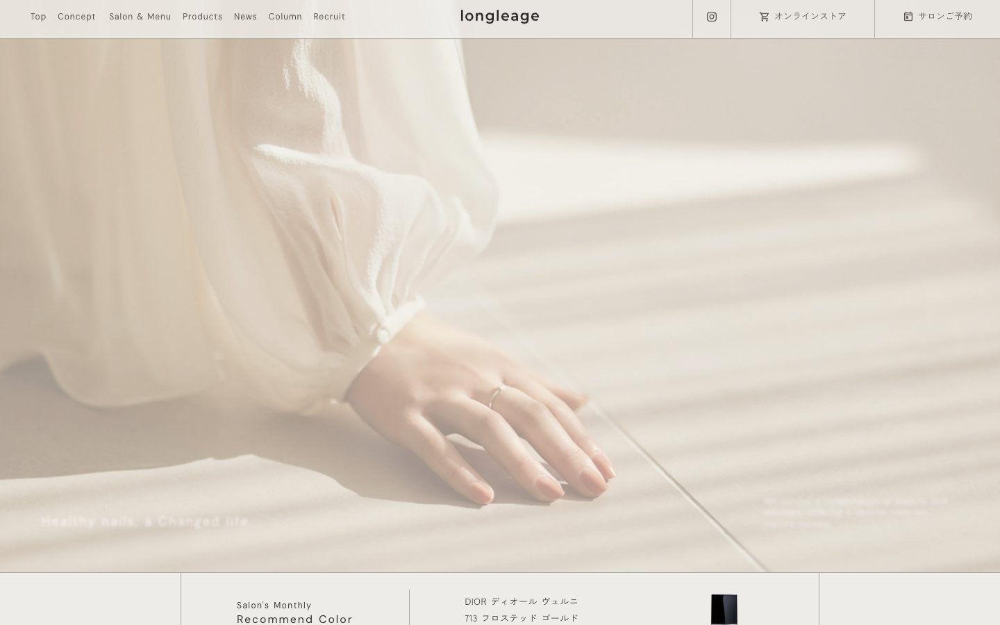
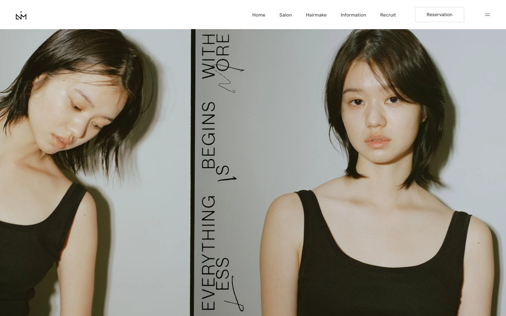
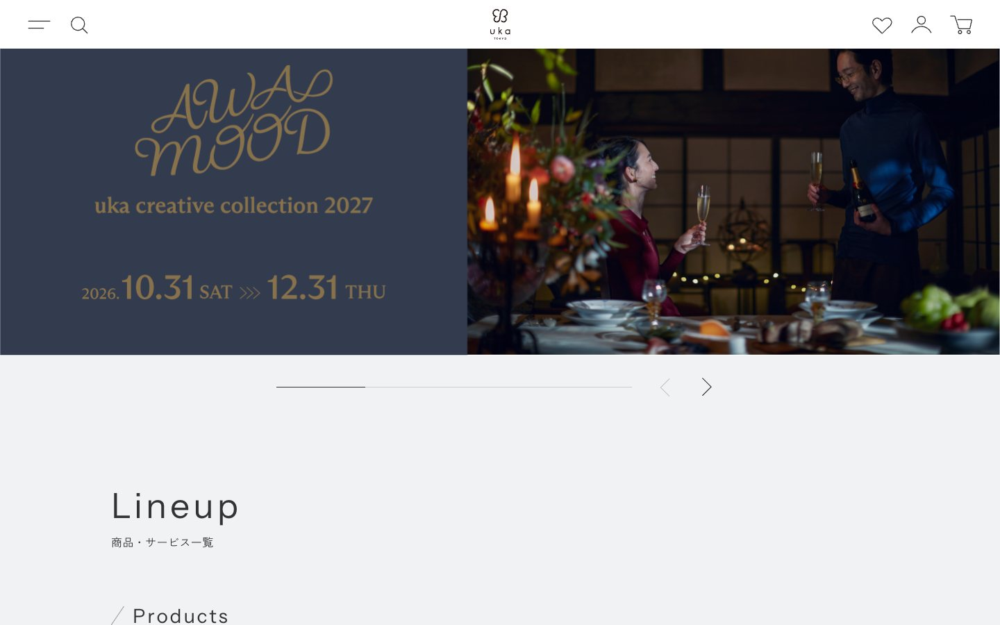
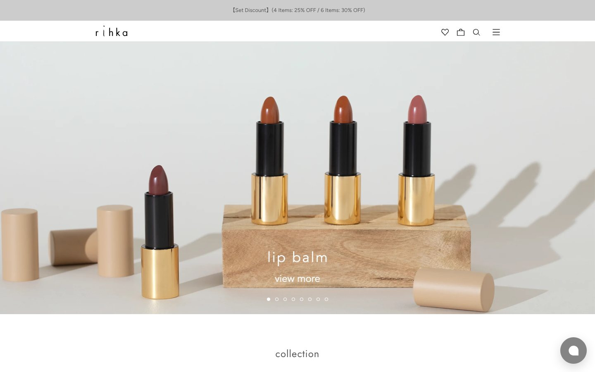
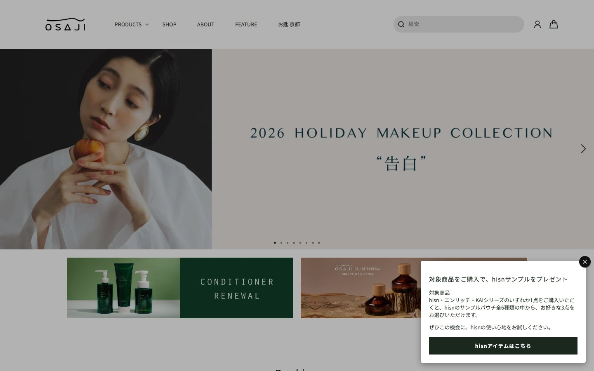
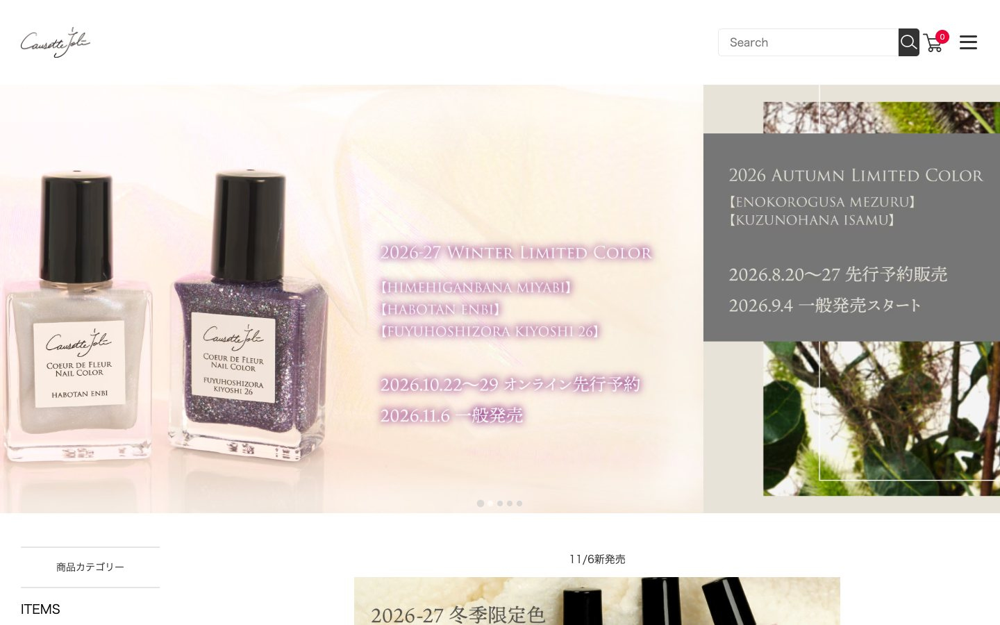
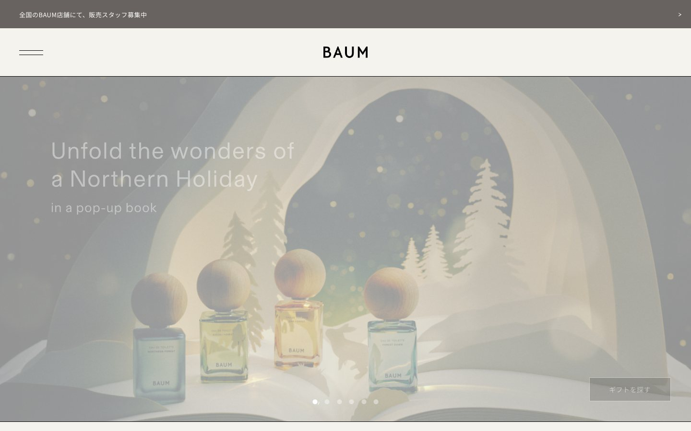
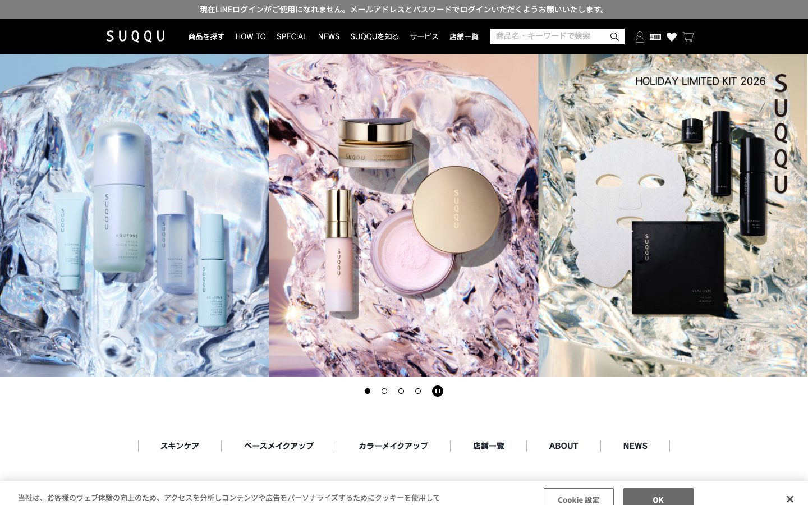
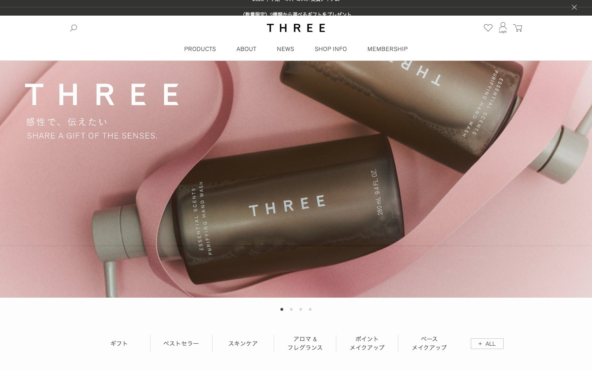
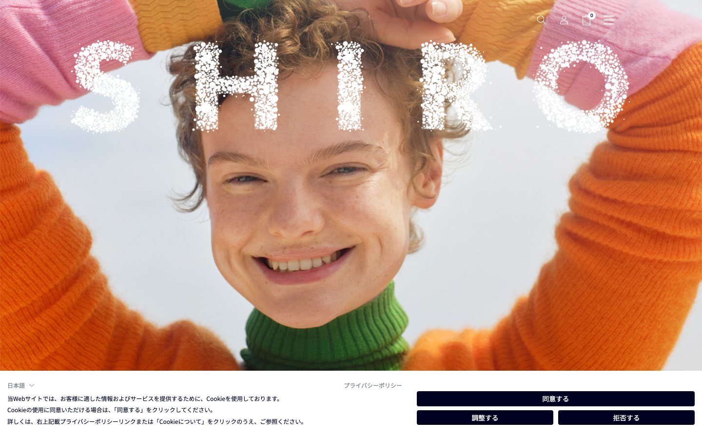

# v5 视觉与气质调研：10 家日本高端美甲沙龙与美妆品牌拆解

> 调研目标（对应 `docs/v5-execute.md` 3.1 与 `docs/review-grok-v5-creative-direction.md` 2A/2B）：
> 只借**气质、光影控制、手部虚化策略、留白尺度与日文排版完成度**，不复制任何具体画面、文案或创意。重点回答一个核心问题：**为什么日本顶级美甲/美妆视觉从不把一只毛孔毕现的真手生硬摊在画面中央，却依然让人一眼看懂色彩、光泽与高级感？**

---

## 1. 10 个真实参考对象与逐项拆解

### 01 · LONGLEAGE（ロングルアージュ｜広尾・銀座 老舗ネイルケアサロン）
- **官网**：https://longleage.co.jp/
- **实截画面**：
  
- **借了什么**：
  - **手的"去写实化"与符号化**：画面 60% 是透光白纱袖口与百叶窗斜影，手只从纱下轻轻探出下半截，整体笼罩在柔焦暖雾（Soft Diffusion）与低对比调色里——完全看不到毛孔或指节皱纹，唯有五枚透粉珠光指甲反射出清透高光。
  - **用百叶窗光带代替装饰**：背景几乎空无一物，仅靠斜向窗影建立空间纵深与呼吸感。

---

### 02 · virth+LIM / LESS IS MORE（南青山・表参道 ショート＆ニュアンスネイル代表サロン）
- **官网**：https://www.lessismore.co.jp/
- **实截画面**：
  
- **借了什么**：
  - **胶片颗粒与低饱和暖灰底调**：不用数码高清锐化，而是全幅覆盖一层温润的银盐颗粒与暖青灰暗部提亮，让画面天然像一本独立摄影志。
  - **极细手写笔触 + 竖向/错位编辑排版**：信息不装进圆角按钮，而是像杂志内页一样直接排在留白与分界线上。

---

### 03 · uka（ウカ｜表参道・六本木・広尾 トータルビューティー＆ネイルアトリエ）
- **官网**：https://uka.co.jp/
- **实截画面**：
  
- **借了什么**：
  - **时间与氛围叙事**：把美甲放进具体的"时刻与光线"（如烛光黄昏、晨光窗格）中讲故事，而不是白底商品目录。
  - **极简线性顶栏与大尺度留白**：导航极克制，切换指示只用一条 `1px` 极细水平线，彻底摒弃臃肿的胶囊控件。

---

### 04 · rihka（リーカ｜ヘアメイク松田未来ディレクション ネイルポリッシュ）
- **官网**：https://rihka.com/
- **实截画面**：
  
- **借了什么**：
  - **硬朗自然侧光与清晰投影**：素白木座上的色彩阵列靠同一束干净的左上方日照与斜向投影统合在同一物理空间里，不靠阴影滤镜硬贴。
  - **くすみ（灰调）色系的辨识度控制**：哪怕是相近的裸棕、焦糖、灰玫瑰色，也通过高光锐度与质地通透感一眼拉开差距。

---

### 05 · OSAJI（オサジ｜アップリフト ネイルカラー）
- **官网**：https://osaji.net/
- **实截画面**：
  
- **借了什么**：
  - **文学性的日文命名与大留白明朝体**：半屏深邃阴影肖像 + 半屏温润灰泥色留白，中央只放极克制的衬线/明朝体短词（如「告白」），情绪张力极强。
  - **启发我们的セルフデザイン诗性款名**：客人配出的每一款甲面，都像一首短诗的题名印在纸面上。

---

### 06 · Causette.Joli（コゼットジョリ｜日本四季・二十四節気ネイルブランド）
- **官网**：https://www.causettejoli.jp/
- **实截画面**：
  
- **借了什么**：
  - **和名色卡与纸签实物感**：瓶身贴纸采用带纤维手感的微黄棉纸方签，把季节感融进纸品与排版，而非做成电商标签。
  - **微珠光与细闪在柔光下的层次表达**。

---

### 07 · BAUM（バウム / 資生堂｜樹木と共生するプレステージブランド）
- **官网**：https://www.baumjapan.com/ba/ja/
- **实截画面**：
  
- **借了什么（直接启发方案 A）**：
  - **逆光多层纸艺剧场（Backlit Paper-Cut Theater）**：不用真树真森林，而是用层叠剪纸弧拱 + 柔和背光微粒 + 透明液体瓶折射光斑，既有童话般的商业大片艺术感，又彻底避开了 AI 写实自然物的塑料穿帮感！

---

### 08 · SUQQU（スック｜大人の艶と光彩を描くラグジュアリーコスメ）
- **官网**：https://www.suqqu.com/ja/
- **实截画面**：
  
- **借了什么（直接启发方案 B）**：
  - **微距晶体折射与焦散光斑（Caustics & Prism Refraction）**：用雕塑感的透明冰晶/玻璃棱镜包裹色彩主体，光线穿过玻璃产生冷暖交织的折射波纹，把注意力 100% 推向色彩的"うる艶（水润光泽）"。

---

### 09 · THREE（スリー｜Natural × Honest × Creative）
- **官网**：https://www.threecosmetics.com/
- **实截画面**：
  
- **借了什么（直接启发方案 C）**：
  - **烟熏深棕琥珀 × 灰玫瑰丝带的暗调高级感**：几乎与 `soū nail atelier` 品牌色板（`#2A1D1F` 深棕木 × `#C9989A` 灰粉玫瑰）完全同频——证明日本女性向高端视觉在暖暗调（Warm Dusk Chiaroscuro）下同样极其温柔、性感且极具广告大片张力。

---

### 10 · SHIRO（シロ｜余白の哲学）
- **官网**：https://shiro-shiro.jp/
- **实截画面**：
  
- **借了什么**：
  - **粒子化视觉符号与"不填满的勇气"**：标题本身由呼吸感微粒构成，顶栏图标极小极轻，把整个视口完全交还给主视觉叙事。

---

## 2. 调研提炼出的四条铁律（贯穿 v5 三个方案）

1. **手绝不当"解剖学模特"**：无论用**和纸剪影墨线（方案 A）**、**素烧白瓷雕塑半影（方案 B）**还是**暖暮逆光丝绒剪影（方案 C）**，手只给姿态与轮廓符号，把 100% 的高光、饱和度、通透感与材质细节全部留给**五枚短椭圆甲面**。
2. **UI 即片中实物或空气排版**：彻底消灭网页圆角胶囊按钮、底栏轮播条、进度点。款名、价格、时长、地址、取消规则全部作为真实 HTML 文字"印"在和纸短册、磨砂玻璃铭牌、活版棉纸卡或折形信笺上。
3. **统一的胶片母带层（Film Master Layer）**：每个方案整站覆盖同一套 LUT 调色、同一种细颗粒与暗角，让图片、视频、实时着色器与 HTML 文字长在同一个光学空间里。
4. **每一次换款都必须是一次光学/材质魔术（「啊」的瞬间）**：不靠生硬叠化，而用**和纸毛细晕染成胶（A）**、**棱镜焦散光缝扫描显影（B）**、**暖琥珀流体丝带裹覆凝结（C）**完成甲面转换。
